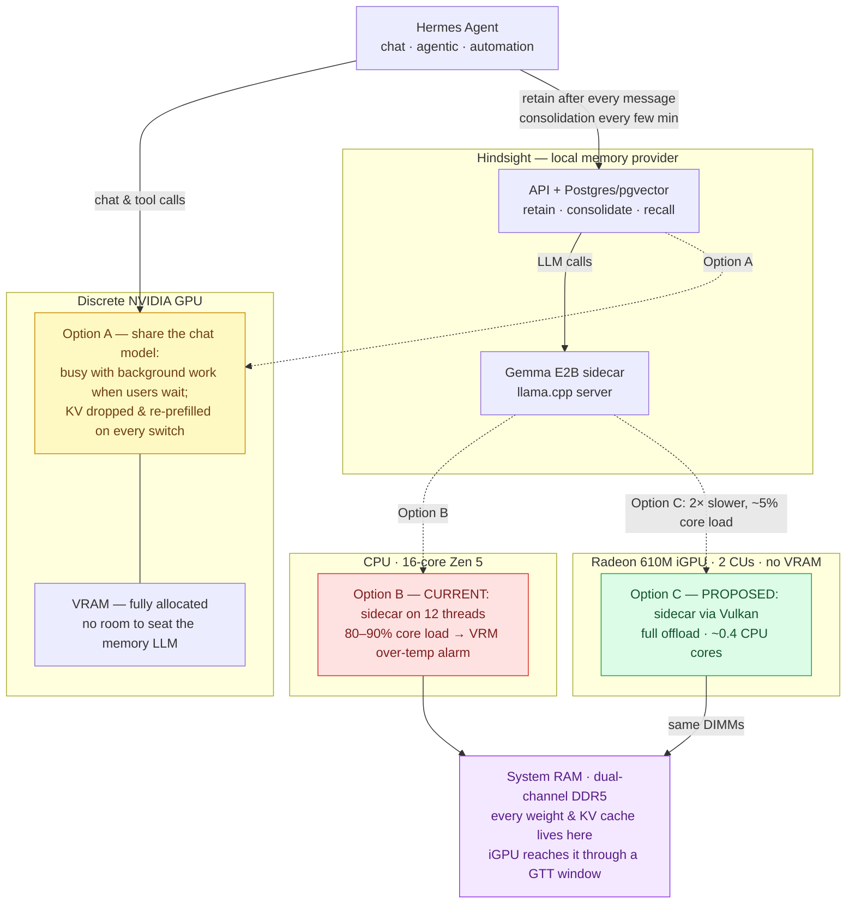

# Radeon 610M as a background-LLM workhorse — llama.cpp benchmark

**Purpose:** answer one practical question — *can a tiny AMD iGPU (the Radeon 610M baked into
Ryzen 9000 desktop chips) take over a small background LLM from the CPU, when the constraint is
not speed but CPU load, CPU temperature, and motherboard VRM thermals?*

## Motivation

The case: an agent-memory pipeline with no cloud LLMs. **Hindsight** runs locally as
the external memory provider for the Hermes Agent; its retain and consolidation phases drive a
small local LLM over captured conversations to distill them into recallable memory units. These
are batch jobs — heavy prefill (consolidation prompts run 10k+ tokens), latency-tolerant by
design, meant to churn away in parallel with everything else.

Three ways to seat the LLM that does this work (Gemma E2B `Q4_K_M`, llama.cpp, `--threads 12`):

- **Option A — share the chat model.** The chat model could run the memory pipeline itself, but
  retention fires after every message and consolidation every few minutes — plus Hermes' own
  memory updates and thread summarization — so the shared endpoint is busy with background work
  precisely when the user expects an answer. And because the two workloads share no prompt
  prefix, every context switch between chat and memory processing drops the KV cache and re-runs
  a prefill of thousands of tokens from scratch.
- **Option B — dedicated sidecar on the CPU** (the current setup). It works, until the cost
  shows up: CPU usage at 80–90%, the board's VRM over-temp alarm trips, and the system bell
  starts beeping.
- **Option C — dedicated sidecar on the iGPU.** The obvious GPU — a large NVIDIA dGPU — is
  already fully committed serving the main chat, agentic, and automation models; there is no
  VRAM left to seat Gemma. That leaves the one "GPU" nobody counts as a GPU: the 2-CU Radeon
  610M. This repo measures **B vs C** head-to-head.

## Architecture at a glance

The three seating options from the Motivation. The benchmark measures Option B against Option C.
Note both sidecar options reach memory through the *same* DIMMs — the iGPU has none of its own.



If your workload is fire-and-forget and your bottleneck is *core current through the VRM*,
this repo measures whether the iGPU is a real option — with the gotchas that make or break
the experiment.

## Results (measured 2026-11-24)

Hardware: 16-core Zen 5 desktop CPU + Radeon 610M iGPU (gfx1103, 2 CUs, no VRAM)
+ dual-channel DDR5. Model: `gemma-4-E2B-it-Q4_K_M.gguf` (3.1 GB, dense in this GGUF —
`n_expert = 0`). llama.cpp b12627 (same build as the production sidecar container), Vulkan
backend from the official ggml release. Same binary, same prompt, `--temp 0`, ctx 8192:

| Run | Prompt eval | **Generation** | CPU cost during decode |
| --- | --- | --- | --- |
| CPU, `-ngl 0`, 12 threads | 689 t/s | **36.7 t/s** | 12 cores at boost clocks → VRM alarm |
| iGPU, `--device Vulkan1 -ngl 99` | 206 t/s | **17.2 t/s** | **~0.4 of one core**, 610M at 100% busy |
| iGPU, `-ngl 15` (half offload) | 188 t/s | 20.9 t/s | both partially hot — worst design |

Offload verified real, not a silent CPU fallback: `-v` log shows
`using device Vulkan1 (…RADV RAPHAEL_MENDOCINO…)` with every layer assigned to it,
and `/sys/class/drm/card1/device/gpu_busy_percent` reads 100% during decode while the llama-cli
process itself stays at ~42% of one core.

## Insights (the parts worth stealing)

1. **The naive FLOPs-ratio prediction is badly wrong.** The 610M has ~1/7 of the CPU's FP32
   throughput, and theory said "~6× slower". Measured: only **2.1× slower** on decode. Both
   paths are memory-bandwidth-bound on the *same* DIMMs (the iGPU is UMA — no VRAM, weights
   stream through the same dual-channel DDR5), so the GPU's weak compute matters far less than
   the FLOPs ratio suggests. A "weak" iGPU can hold ~50% of a 16-core Zen 5's decode speed.
2. **For VRM/thermal relief this is a genuine win: ~47% of the speed for <5% of the core load.**
   The CPU-side cost drops from "12 cores sustained at boost" (tens of amps of Vcore current →
   VRM alarm) to a single fraction of one core babysitting Vulkan command buffers. A 35 s
   consolidation batch becomes ~70 s — irrelevant for background work, priceless for thermals.
3. **Prompt eval (prefill) is the part that actually suffers** — 3.4× slower (689 → 206 t/s).
   Decode-dominated workloads benefit most; prefill-dominated ones less so.
4. **Partial offload (`-ngl` ≈ half the layers) is the worst of both worlds** — both CPU and GPU
   partially busy, no clean thermal story, only 20.9 t/s. Bench `-ngl 0`, full, and half as
   separate runs; ship full or none.
5. **Vulkan is the only sane backend for gfx1103.** ROCm has no official support for the 610M
   (`gfx1103`); RADV + llama.cpp Vulkan works out of the box. Caveat: `matrix cores: none` —
   no tensor-core acceleration, pure shader math.
6. **Device targeting is a trap.** `--list-devices` usually enumerates the *discrete* NVIDIA GPU
   as `Vulkan0` — an accidental "iGPU" benchmark silently runs on the gaming GPU (on the test
   machine the dGPU had only a few hundred MiB free, already fully occupied by the chat model). Worse,
   `--device "<full device name>"` is **rejected** even when copied verbatim from
   `--list-devices`; use the index form (`--device Vulkan1`). Guard with
   `GGML_VK_DISABLE_NVIDIA=1` as belt-and-braces.
7. **Verify the number is real.** gpu_busy% of 100 + near-zero process CPU during decode is the
   signature of a genuine iGPU decode; anything else and you may be timing a CPU fallback.

## Setup

Requirements: Linux, Mesa/Vulkan (RADV), `/dev/dri/renderD*` accessible, a GGUF a few GB or smaller.

1. **Get a Vulkan-enabled llama.cpp build.** Download the official release asset
   `llama-b<NNNN>-bin-ubuntu-vulkan-x64.tar.gz` from
   [ggml-org/llama.cpp releases](https://github.com/ggml-org/llama.cpp/releases) and extract it
   so the binaries sit in `./llama-b<NNNN>/` next to this README (flat layout — the archive has
   no `bin/` subdir; run with `LD_LIBRARY_PATH=.`, which the script does). Pick the **same build
   number as the deployment you are modeling** (`docker exec <sidecar> /app/llama-server --version`)
   so the CPU baseline is comparable.

2. **Confirm the iGPU is enumerable:**

   ```bash
   LD_LIBRARY_PATH=./llama-b12627 ./llama-b12627/llama-cli --list-devices
   # Vulkan0: NVIDIA GeForce RTX ...            <- NOT the target
   # Vulkan1: AMD Ryzen ... (RADV RAPHAEL_MENDOCINO) ...  <- the 610M
   ```

   Note the index name of the AMD device; that is your `IGPU_DEVICE`. (If you only have the
   iGPU, it will be `Vulkan0`.)

3. **Point the script at your model** and run:

   ```bash
   MODEL=/path/to/model-Q4_K_M.gguf ./gemma-610m-vs-cpu.sh 128
   # knobs (env): MODEL, BENCH_DIR, IGPU_DEVICE, THREADS, CTX
   ```

   It runs three passes (CPU / full iGPU offload / half offload) with the same prompt and
   `--temp 0`, and prints prompt-eval and generation t/s per run. Full logs land in
   `/tmp/bench_{cpu,igpu,igpu_half}.txt`.

4. **Optional — verify the offload is genuine** during an iGPU run:

   ```bash
   watch -n1 cat /sys/class/drm/card1/device/gpu_busy_percent   # card1 = iGPU (check device/vendor == 0x1002)
   ```

   100% busy with near-idle process CPU = genuinely on the iGPU.

## Interpreting for your box

- This GGUF ran with all layers resident in the iGPU's GTT aperture (a large slice of system
  RAM was visible to it at rest; allocations >4 GB may need the BIOS "GTT size" raised).
- The trade only makes sense for **background/batch** workloads where wall-clock ×2 is free and
  CPU cores/VRM power are the scarce resource. Anything interactive should stay on the CPU (or a
  real GPU).
- On AMD APUs one class up (Radeon 780M/890M, 12–16 CUs), the iGPU can *beat* the CPU path —
  the conclusions here are for the 2-CU bottom-shelf part, the hardest case.

## Repo layout

- `gemma-610m-vs-cpu.sh` — the benchmark (defaults tuned for the author's box; override via env).
- `llama-b12627/` — not committed; download per Setup step 1.
